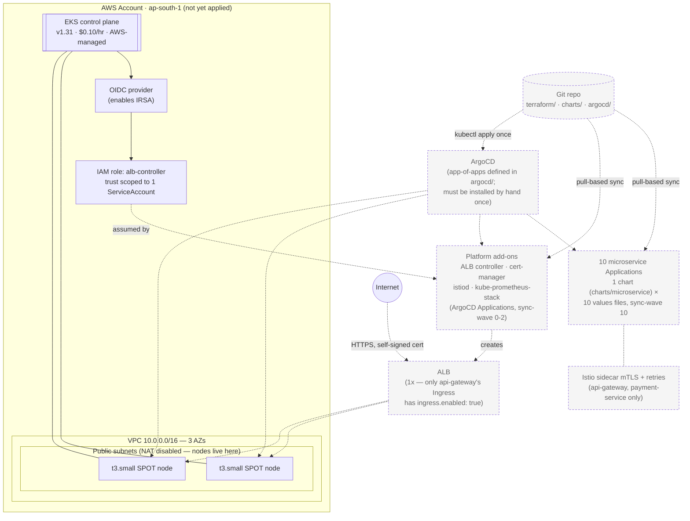

# eks-platform

A cost-conscious AWS EKS platform — Terraform for the cluster, ArgoCD
(GitOps) for 10 demo microservices behind Istio, cert-manager, and an ALB —
built as a DevOps portfolio project, with every cost and security trade-off
written down and justified.

> **Status: in progress.** Two layers exist today, and they haven't met yet:
> **(1) Infrastructure** — `terraform/` provisions the VPC, EKS cluster,
> node group, and the ALB controller's IRSA role. Nobody has run
> `terraform apply` against a real AWS account yet (no state, no live
> cluster). **(2) GitOps/application layer** — `charts/` (one generic Helm
> chart + 10 per-service values files) and `argocd/` (a complete app-of-apps:
> cert-manager, Istio, kube-prometheus-stack, metrics-server, the ALB
> controller, and 10 microservice Applications, all sync-wave ordered) are
> fully written. **ArgoCD is installed by Terraform** (`terraform/argocd.tf`,
> a `helm_release` sized down for `t3.small` nodes) which then applies
> `argocd/root-app.yaml`, handing the cluster over to GitOps. From that point
> Terraform stays out of Kubernetes entirely.
>
> Two setup steps remain manual by necessity: copying the state bucket name
> from `bootstrap/` into `terraform/backend.tf` (a backend cannot store its
> own state), and running `scripts/patch-account-id.sh` to stamp the AWS
> account ID into the ALB controller's IRSA annotation (a static GitOps
> manifest cannot read Terraform state). Both are one-time and documented
> below. See [docs/DESIGN-DECISIONS.md](docs/DESIGN-DECISIONS.md).

---

> [!WARNING]
> **The EKS control plane costs $0.10/hour with no free tier**, billed from
> the moment `terraform apply` finishes until the cluster is deleted —
> whether or not anything is running on it. This config's full burn rate is
> roughly **$0.13/hour (~$95/month)** while applied. Always run `make down`
> when you're done. See [docs/COST.md](docs/COST.md) for the full
> breakdown and the "forgot to destroy" math.

---

## Architecture



*Solid lines/boxes = created directly by `terraform apply` in this repo
today. Dashed = defined as code (Helm chart, ArgoCD Applications) but not
running — they only come alive once a cluster exists **and** ArgoCD is
installed into it by hand, which nothing here automates yet.* Full
reasoning behind each choice — managed node groups, IRSA, GitOps, SPOT,
NAT, remote state, the one-chart-many-values layout, Istio sidecar cost on
small nodes — is in
[docs/DESIGN-DECISIONS.md](docs/DESIGN-DECISIONS.md).

## What each component does

- **VPC (`terraform/vpc.tf`)** — a 3-AZ VPC with both public and private
  subnets defined, but with `enable_nat_gateway = false` by default so
  worker nodes are placed in the **public** subnets and reach the internet
  directly, avoiding the ~$32/month NAT Gateway would otherwise cost.
  Subnets are tagged for the AWS Load Balancer Controller's auto-discovery
  (`kubernetes.io/role/elb`, `kubernetes.io/role/internal-elb`).
- **EKS cluster + managed node group (`terraform/eks.tf`)** — an EKS 1.31
  control plane with a public endpoint, IRSA enabled, the creating
  identity granted cluster-admin, core add-ons (`coredns`, `kube-proxy`,
  `vpc-cni`, `eks-pod-identity-agent`), and one managed node group running
  2–4 `t3.small` **SPOT** instances.
- **IRSA (`terraform/irsa.tf`)** — an IAM role and policy for the AWS Load
  Balancer Controller, trusted only by its specific ServiceAccount via the
  cluster's OIDC provider — not by the node role. The
  `argocd/apps/platform/aws-load-balancer-controller.yaml` Application is
  written to assume this exact role, but a real AWS account ID has to be
  pasted into it by hand first (GitOps manifests are static; they can't
  read Terraform output) — see the comment at the top of that file.
- **Bootstrap (`bootstrap/`)** — a one-time, local-state Terraform root
  that creates the S3 bucket (versioned, encrypted, public access blocked)
  and DynamoDB table used as `terraform/`'s remote backend and lock.
- **`charts/microservice/`** — one generic Helm chart (Deployment, Service,
  HPA, Ingress, ServiceAccount, ServiceMonitor, and Istio
  VirtualService/DestinationRule, all templated and opt-in) backing all 10
  demo services. **`charts/values/svc-01.yaml` … `svc-10.yaml`** are the
  10 per-service values files — only `api-gateway` (svc-01) turns on
  Ingress + HPA + the Istio sidecar; `search-service` (svc-08) also gets
  an HPA; `payment-service` (svc-06) also gets the Istio sidecar; the
  other 7 stay fixed at 1 replica, ClusterIP-only, to fit a 2-node
  `t3.small` budget.
- **`argocd/`** — the app-of-apps: `root-app.yaml` (the one manifest applied
  by hand, once ArgoCD exists) watches `argocd/apps/` recursively.
  `argocd/apps/platform/` (sync-waves -10 to 2) installs namespaces,
  metrics-server, cert-manager (+ a self-signed `ClusterIssuer`, since this
  sandbox has no public domain for ACME), Istio (`istio-base` + `istiod`,
  deliberately **no** `istio-ingressgateway` — north-south traffic stays on
  the ALB), kube-prometheus-stack, and the ALB controller.
  `argocd/apps/*.yaml` (sync-wave 10, after the platform is healthy) are
  the 10 microservice Applications, each the same chart pointed at a
  different values file.
- **Docs (`docs/`)** — [DESIGN-DECISIONS.md](docs/DESIGN-DECISIONS.md)
  (trade-off reasoning for every major choice) and
  [COST.md](docs/COST.md) (full cost breakdown, teardown checklist).

## Prerequisites

- [Terraform](https://developer.hashicorp.com/terraform/install) >= 1.5
- AWS CLI v2, configured with credentials that can create VPC/EKS/IAM
  resources (`aws sts get-caller-identity` should succeed)
- `kubectl`
- An AWS account — this targets `ap-south-1` by default (see
  `terraform/variables.tf` to change it)
- `make` (all commands below are `make` targets — run `make help` any time)

`make validate` is the one command in this repo that works **without** any
of the above except Terraform itself — useful for CI or a quick sanity
check before touching AWS credentials at all.

## Quickstart

```bash
# 0. One-time: create the S3 state bucket + DynamoDB lock table (local state)
make bootstrap
# -> copy the printed `backend_config` output into terraform/backend.tf
#    (that file doesn't exist until you do this — it's a deliberate
#    chicken-and-egg step, see docs/DESIGN-DECISIONS.md §6)

# 1. Initialize the main stack against that backend
make init

# 2. Sanity-check the config — works offline, no AWS credentials needed
make validate

# 3. See what Terraform would create (needs AWS credentials)
make plan

# 4. Apply — THIS STARTS THE $0.10/hr BILLING CLOCK
make up

# 5. Point kubectl at the new cluster
make kubeconfig
kubectl get nodes

# ... do your demo / interview walkthrough / testing ...

# 6. Tear it all down when you're done
make down
make destroy-check   # confirms nothing billable is left in ap-south-1
```

Run `make help` for the full target list (`fmt`, `lint`, `status`, `cost`,
and more), or `make cost` for the burn-rate table without leaving the
terminal.

## Repo layout

```
eks-platform/
├── bootstrap/                # one-time: S3 state bucket + DynamoDB lock table (local state)
│   ├── main.tf
│   ├── variables.tf
│   └── outputs.tf
├── terraform/                # main stack: VPC, EKS cluster, node group, IRSA
│   ├── providers.tf
│   ├── variables.tf
│   ├── vpc.tf
│   ├── eks.tf
│   ├── irsa.tf
│   ├── outputs.tf
│   └── policies/
│       └── alb-controller-policy.json
├── charts/
│   ├── microservice/          # the one generic chart backing all 10 services
│   │   ├── Chart.yaml
│   │   ├── values.yaml        # conservative defaults — everything opt-in
│   │   └── templates/         # deployment, service, hpa, ingress, serviceaccount,
│   │                          # servicemonitor, virtualservice, destinationrule
│   └── values/                # 10 per-service values files (svc-01..svc-10)
├── argocd/
│   ├── root-app.yaml          # the one manifest applied by hand; self-manages from here
│   ├── apps/
│   │   ├── platform/          # cert-manager, Istio, kube-prometheus-stack,
│   │   │                      # metrics-server, ALB controller, namespaces
│   │   └── *.yaml             # one Application per microservice (chart + values file)
│   └── manifests/             # plain-YAML pieces platform Applications point at
│       ├── namespaces/
│       ├── cert-manager/      # self-signed ClusterIssuer
│       └── istio/             # mesh-wide PeerAuthentication (STRICT mTLS)
├── apps/                      # (placeholder) demo microservice source — not written yet
├── docs/
│   ├── DESIGN-DECISIONS.md    # the "why" behind every major choice
│   └── COST.md                # per-resource cost table, teardown checklist
├── Makefile
├── README.md
└── .gitignore
```

## Stack

Terraform · AWS EKS 1.31 · IRSA/OIDC · Helm · ArgoCD (app-of-apps) · Istio ·
cert-manager · kube-prometheus-stack · AWS Load Balancer Controller

The Terraform (VPC/EKS/IRSA/ArgoCD) and the GitOps layer (Helm chart +
ArgoCD Applications) are fully written and `terraform validate`-clean, but
nothing has been applied to a real AWS account yet — see the status note at
the top of this file.

## Further reading

- [docs/DESIGN-DECISIONS.md](docs/DESIGN-DECISIONS.md) — why managed node
  groups over Fargate/self-managed, why IRSA, why GitOps over push CD, why
  SPOT and what breaks on interruption, why NAT is disabled and what
  production does differently, why S3+DynamoDB state locking, why one
  generic Helm chart, and an honest look at Istio's sidecar overhead on
  `t3.small`.
- [docs/COST.md](docs/COST.md) — hourly/daily/monthly cost per resource,
  the "forgot to destroy" scenario, and the teardown checklist.
